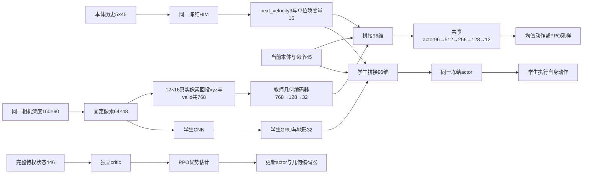

# Black共享actor训练架构审查快照

状态：当前已实现的v1与“从头训练”待改方案分列。本次不改变运行入口，不删除历史权重，不启动训练。当前默认仍加载r800，不能标成已经支持全模块从零训练。

## 当前训练链

相机10Hz、控制50Hz。动作顺序FL/FR/RR/RL×hip/thigh/calf，比例0.25，保留原0–2步执行器延迟。

|阶段|可训练模块|固定模块|监督与梯度|
|---|---|---|---|
|教师PPO|actor、可见几何编码器、Gaussian std、critic|HIM与其输入语义|策略梯度经actor进入几何编码器；价值损失只更新critic|
|学生蒸馏|CNN+GRU|完整教师、actor、HIM|动作均值与地形32两个Huber目标detach；动作损失穿过冻结actor对输入的梯度|

教师actor使用本体、命令历史及相机可见地形；地形分支仅使用相机可见信息。特权信息通过critic的价值估计影响PPO更新，不直接塞入动作输入。更容易训练仍需实际对照，代码结构本身不能证明收敛优势。

## 当前初始化的真实状态

|模块|v1默认来源|从新开始时需做什么|
|---|---|---|
|actor|r800 learner.head|新实例随机初始化；不读旧head|
|HIM主编码器|r800 frontend.encoder，冻结|保留已验证HIM则须明确不叫“全部模块从零”；严格全新需要新增HIM学习阶段|
|教师几何编码器|随机|新建并记录seed|
|critic及统计、Gaussian std、Adam|新建|重建，计数归零|
|学生CNN+GRU|r800 frontend.depth_encoder和gru|新建并记录来源；学生开始时禁止沿用教师bundle内旧视觉权重|
|学生actor|直接引用teacher.actor|教师训练好后使用同一份actor；禁止再随机重建第二个头|

checkpoint.initial_models仍绑定r800文件SHA；save_bundle仍固定写initial_source_sha256为r800。仅删除.pt会使启动失败。make_modules虽然不加载旧文件，但会把随机HIM冻结，不能直接代替从零训练入口。

## 从头训练的待实施改动

1.将旧模型保留为只读历史，训练入口明确选择新初始化，切断旧head/CNN/GRU的加载。清空Adam、critic统计、轮数和GRU隐藏状态。
2.明确HIM范围：若保留旧HIM，方案应称“新策略与视觉从零”；若所有模块均新建，先补HIM监督训练及验证，再固定同一HIM供教师与学生使用。不能随机冻结HIM后声称HIM已学会估计。
3.为新初始化记录独立模型版本、seed和逐模块来源，去掉固定r800来源字段；保留显式bundle/学习器恢复的身份区分。
4.教师先完成基础平地、纯轴低速起动/反转/停车，再逐级楼梯并维持平地样本。当前25%平地/75%楼梯配置不是已经验收的全随机冷启动配方。使用与诊断不同的训练seed，不能照搬测试轨迹后宣称泛化。
5.新教师完成独立多seed资格验证后，学生CNN+GRU从新参数学习；actor/HIM继续使用这一个合格教师的固定权重。

以上是待审查方案，当前上传代码没有实现这些新初始化步骤。头的输入宽度仍为96，主要变化是共享关系及地形32语义；重置权重有利于消除旧表示依赖，但当前数据不足以证明它一定比迁移初始化更快。

## 已验证范围和剩余风险

101项候选CPU测试，26个Python文件Ruff/格式/ty/Pyright通过。教师有限学习器续算累计2round/40次Adam。五次独立GPU诊断均0优化；完整窗口结果flat29/32、axes10/24、4cm双向0/2。教师尚未合格，学生正式门关闭。

black_reliability隔离候选已在Win完成4096环境×24步零更新验证；原正式入口未切换，共享actor_v1未部署Win。

历史NaN根因未定位；Win历史证据仅定位到一个控制步内。现有首坏探针能进一步区分动作写入、sim.step、事件/reset等边界，仍需捕获真实故障。完整物理复现还需要坏步之前的积分/约束热启动、接触与延迟缓冲、随机事件及软件/GPU身份等状态。

固定采样可能漏薄物体；冻结HIM在新策略下的分布变化需验证；纯timeout使用V(s_t)近似；GRU长episode前缀是截断近似；旧楼梯课程pass_timeout_no_stop可晋级，不能代替严格停车资格；原strict仅0.12秒稳定；学生GPU学习器恢复、4096规模新架构长时稳定性、导出和实机链尚未验收。

## 与GitHub主分支的已核实接口差异

核验基准为主分支提交2913d3f449f8eb5b0505156c460ad2f61e4c49fd。以下差异来自实际代码，当前reviews归档不会改变这些生产接口。

|接口|GitHub主分支|本地共享actor候选|
|---|---|---|
|actor关节与动作顺序|FL→FR→RL→RR|FL→FR→RR→RL|
|45维观测command位置|0:3，缩放(2,2,0.25)|30:33，无额外缩放|
|HIM历史|6帧，进入编码器前转为新→旧|5帧，旧→新直接展平|
|HIM编码器输入|每帧去command，6×42=252|保留command，5×45=225|
|critic输入|259维|446维|

直接把本地权重放入主分支任务会遇到维度不兼容或控制语义错位。即使全部从头训练，也必须先明确采用哪套观测与动作约定，再统一训练、导出和部署；仅交换两条后腿不能完成接入。远端critic的关节顺序另为FL→FR→RR→RL，不能据此判断actor与本地相同。

远端代码依据：[关节定义](https://github.com/5junchen9/alldog_mjlab/blob/2913d3f449f8eb5b0505156c460ad2f61e4c49fd/src/alldog_mjlab/robots/black/black_constants.py#L23-L30)、[动作构造](https://github.com/5junchen9/alldog_mjlab/blob/2913d3f449f8eb5b0505156c460ad2f61e4c49fd/src/alldog_mjlab/tasks/black/env_cfg.py#L213-L228)、[actor观测](https://github.com/5junchen9/alldog_mjlab/blob/2913d3f449f8eb5b0505156c460ad2f61e4c49fd/src/alldog_mjlab/tasks/black/env_cfg.py#L358-L397)、[6帧历史](https://github.com/5junchen9/alldog_mjlab/blob/2913d3f449f8eb5b0505156c460ad2f61e4c49fd/src/alldog_mjlab/tasks/black/mdp/him.py#L57-L66)、[历史反转及去command](https://github.com/5junchen9/alldog_mjlab/blob/2913d3f449f8eb5b0505156c460ad2f61e4c49fd/src/alldog_mjlab/algorithms/him/spec.py#L80-L96)。

本地依据：候选checkpoint.py:23–28、runtime.py:147–158、model.py:40–42；原项目src/mjlab/tasks/velocity/config/black_teacher/student_env_cfg.py:14–43及black_reliability_20261119/student/him_base.py:33–38。

## 代码与复现范围

source/包含原候选的26个Python源码/测试文件及配置快照，保持原字节。该目录是审查快照，当前sys.path和ROOT计算依赖原工程位置，不能直接从这里运行。

原项目相对位置为preparation/rough_v2/shared_actor_v1_20261119，依赖同级black_reliability_20261119/student与fault、stairs_passage_course_candidate_20261117、terrain446_success12335_20261112、student_direct160_adapter_candidate_20261116、structural_stoprepair_v7_fix1_candidate_20261115/candidate_source下的specialty环境，以及项目src、机器人资产和原锁定运行环境。当前GitHub主分支另有任务布局，不能假定直接覆盖即可兼容。

本快照未上传模型、原始大轨迹、Win目录或整个旧工程。完整逐步评估证据位于本地Black评估代码与证据.zip，文件级索引与hash见ARTIFACT_INDEX.json。validation/为本地既有检查的摘要，不表示GitHub重新执行了测试。
